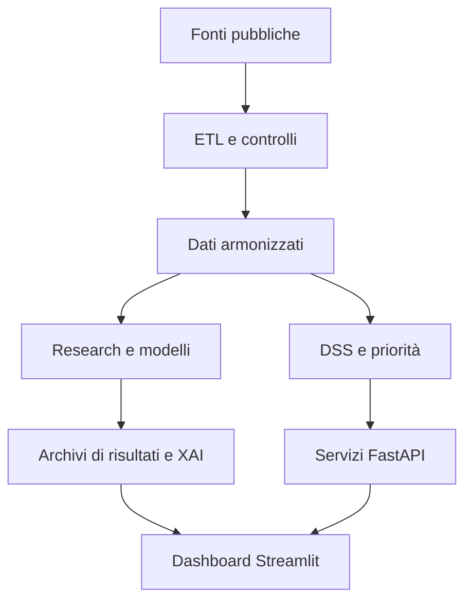

# OneHealthAI Frontend e dashboard

## Il progetto completo

OneHealthAI integra dati pubblici ambientali, sanitari, meteorologici e demografici della Regione Puglia per studiare la relazione tra qualità dell’aria e indicatori sanitari. I prodotti seguono gli stessi territori nel tempo: ASL per anno, comuni per anno e comuni per mese.

Il percorso Research esamina le associazioni e misura se gli inquinanti migliorano le previsioni rispetto a riferimenti basati sullo storico sanitario. Il Decision Support System (DSS) permette di confrontare indicatori e priorità territoriali con pesi espliciti. Le spiegazioni SHAP descrivono il contributo delle variabili alle previsioni; il dettaglio dello score descrive invece il calcolo delle priorità.

Il lavoro riguarda qualità dell’aria e salute umana. Il prototipo supporta consultazione e ricerca; non è un dispositivo clinico né un sistema validato per raccomandazioni sanitarie automatiche.

## Architettura del sistema



I microservizi restano componenti distinti nel backend. I moduli ETL sono mantenuti nel backend perché richiamati anche dai servizi; gli script che preparano i pannelli e conducono gli esperimenti appartengono al repository Data & Research. Il frontend interroga le API e legge alcuni archivi di risultati predisposti. I percorsi originali sono conservati: per eseguire insieme i componenti si genera una copia di lavoro comune, senza mescolare i loro repository Git.

## Repository dei componenti

- [Backend e servizi](https://github.com/UniSalento-IDALab-corsoPerfez-25-26/perfez-2526-onehealth-backend-stefanizzi)
- [Frontend e dashboard](https://github.com/UniSalento-IDALab-corsoPerfez-25-26/perfez-2526-onehealth-frontend-stefanizzi)
- [Dati e ricerca](https://github.com/UniSalento-IDALab-corsoPerfez-25-26/perfez-2526-onehealth-data-research-stefanizzi)
- [Presentazione del progetto](https://github.com/UniSalento-IDALab-corsoPerfez-25-26/perfez-2526-onehealth-presentazione-stefanizzi)

## Il componente di questo repository

Interfaccia Streamlit per monitoraggio ambientale, qualità e copertura dei dati, confronto delle ASL e spiegazioni delle previsioni.

- `app/dashboard/main.py`: ingresso della dashboard.
- `app/dashboard/pages/quality_coverage.py`: qualità e copertura dei dati.
- `app/dashboard/territorial_priorities.py`: confronto degli scenari di priorità.
- `app/dashboard/experimental_forecasts.py` e `ridge_explanations.py`: consultazione delle previsioni e dei contributi delle variabili.
- Gli altri moduli della stessa cartella gestiscono grafici, serie storiche, monitoraggio e navigazione.

## Provenienza della consegna

La suddivisione conserva i sorgenti della copia di lavoro indicata al generatore. Il file `REPOSITORY_MANIFEST.json` registra i percorsi originali e le impronte SHA-256 dei file trasferiti. Un file sorgente ha un solo repository proprietario; non vengono modificate le formule o le configurazioni degli esperimenti per realizzare la suddivisione.

## Preparazione dell’esecuzione integrata

Usare Python 3.12 o successivo. Collocare i tre repository del codice nella stessa cartella. Per esempio, da una nuova cartella di destinazione:

```bash
git clone https://github.com/UniSalento-IDALab-corsoPerfez-25-26/perfez-2526-onehealth-backend-stefanizzi.git
git clone https://github.com/UniSalento-IDALab-corsoPerfez-25-26/perfez-2526-onehealth-frontend-stefanizzi.git
git clone https://github.com/UniSalento-IDALab-corsoPerfez-25-26/perfez-2526-onehealth-data-research-stefanizzi.git
```

Dalla cartella che contiene i tre cloni:

```bash
python perfez-2526-onehealth-backend-stefanizzi/tools/assemble_workspace.py --output ../OneHealthAI_workspace
```

Il comando crea una **nuova copia di esecuzione** con i percorsi attesi dal codice. Controlla che i file non siano mancanti o modificati rispetto alla consegna e rifiuta destinazioni già popolate. Non modifica i tre repository, non copia il `.env`, non avvia servizi e non calcola risultati.

Nella nuova cartella:

```bash
cd ../OneHealthAI_workspace
python -m pip install -r requirements.txt
```

Quindi configurare il `.env` e predisporre gli input richiesti. Per i comandi operativi consultare `README_WORKSPACE.md`, generato nell’assemblaggio. Se si modifica intenzionalmente il codice di una componente dopo la consegna, aggiornare il manifest o usare `--allow-modified` per assemblare quella copia dichiaratamente modificata.

La cartella di esecuzione non è un quinto componente: è una copia locale generata e non va pubblicata come repository aggiuntivo.

## Dati e configurazione

I repository contengono codice e configurazioni non riservate. Dati ARPA/ISTAT/AReSS, prodotti Parquet/CSV, risultati e database sono distribuiti separatamente e devono rispettare i percorsi registrati nei cataloghi e nei protocolli. Per l’esecuzione completa servono anche PostgreSQL/PostGIS e, per lo stack a microservizi, Docker.

`.env.example` contiene soltanto segnaposto. Il `.env` locale con le credenziali non va aggiunto a Git. Le viste che leggono risultati archiviati richiedono quei file; il solo codice non sostituisce il patrimonio dati del progetto.

## Verifiche

La preparazione dei repository verifica sintassi Python, assegnazione univoca dei sorgenti e corrispondenza delle impronte. L’assemblaggio è verificabile senza avviare applicazioni. I test applicativi completi richiedono gli input e i servizi pertinenti; la separazione dei repository non costituisce una nuova campagna scientifica o una validazione clinica.

## Autrice

Maria Laura Stefanizzi · Università del Salento · 2025–2026.
